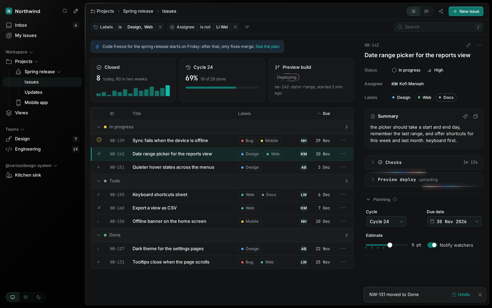

# @xerios/design-system

[](https://www.npmjs.com/package/@xerios/design-system)

A note of warning: This is **designed for personal use and building local web-apps**, so no cross-browser tests have been performed.

A Linear-style design system for Svelte 5 apps: theme tokens (light and dark), a global CSS layer, and generic
components (inputs, menus, popovers, tooltips, collapsibles, toasts). Dense, quiet, keyboard-first.



Nothing in it knows about the apps that use it: anything domain-specific stays in the app.

Plain JavaScript with JSDoc types, Svelte 5 runes. It ships as Svelte source (compiled by your bundler, like any
Svelte library) with generated `.d.ts` files, so TypeScript apps get props and helpers checked.

## Use it in an app

1. Install it (Svelte 5.29+ is a peer dependency):

   ```sh
   pnpm add @xerios/design-system
   ```

   Any Svelte 5 setup works: SvelteKit, or Vite with `@sveltejs/vite-plugin-svelte`.

2. Load the global layer once, in the entry file (or root `+layout.svelte`), before your own CSS:

   ```js
   import '@xerios/design-system/fonts.js' // Inter + JetBrains Mono, bundled (optional: see Fonts)
   import '@xerios/design-system/css/index.css' // tokens, base, effects, atoms
   import './app.css' // yours, after
   ```

3. Mount the singletons at the root: `<ContextMenu />` (any `contextMenu` attachment or `MenuButton`; it also keeps
   the browser's drag and right-click menu off controls, see `lib/controls.js`), and if you use them `<Dialogs />` (`alertDialog`, `confirmDialog`, `promptDialog`) and `<Toast … />`.
4. Import components by name from the package root, `import { Select, Icon } from '@xerios/design-system'`, or by
   path, `import Select from '@xerios/design-system/components/inputs/Select.svelte'` (helpers under `/lib/…`).

## What's in the package

The source lives in `src/` and is published from `dist/` (the same tree plus `.d.ts` files); import paths leave both
out (`@xerios/design-system/components/…`). Paths elsewhere in this README are relative to `src/`.

```
css/index.css        imports the four files below, in order
css/tokens.css       every token, light and dark
css/base.css         reset, body type, selection rules, scrollbars, links, focus rings, kbd, utilities
css/effects.css      scroll fades, new-content glow, lit edge, corner glow, shine, shell atmosphere, shimmer, spotlight, dialog motion
css/atoms.css        .btn, .icon-btn, .data-table, .count, tones, .label-chip, .chip-btn, .field-label, .label-note, .new-dot, .prose
components/          generic components (table below)
components/inputs/   form controls
components/menu/     the context menu layer
components/tiles/    tiles and the tile group
components/action-card/ a card with its actions (ActionCard, ActionCard.Action)
components/metadata/ labelled values (Metadata, Metadata.Row)
components/filters/  filter rows (FilterBar, FilterBar.Chip, FilterBar.Options)
components/icons.js  the built-in glyphs as SVG strings (generated by scripts/icons.js)
lib/                 dom.js, dialogs.svelte.js, motion.js, scroll-fade.js, validity.js, tooltip.js, field-errors.svelte.js, menu.svelte.js, controls.js, inline-md.js, spotlight.js, edge-glow.js
fonts.js             bundles the two typefaces
index.js             named exports of everything
```

The repo also holds `kitchensink/` (a private preview app, see Kitchen sink) and `scripts/`; neither is published.

## Theme

Light by default, dark when the OS asks for it. `<html data-theme="light">` or `data-theme="dark"` overrides
the OS. To avoid a flash, set the attribute from a small inline script in `index.html` before the page paints
(`kitchensink/index.html` shows how). Each colour token is one `light-dark(light, dark)` pair, and the theme
only sets `color-scheme`. A non-colour value that differs by theme can't use `light-dark()`; it would be set per theme.

## Tokens

All in `css/tokens.css`. Components read tokens only, never raw colours or pixel radii.

| Group                                     | Tokens                                                                                                                                                                                                                                                                                                                                                                                                                                             |
| ----------------------------------------- | -------------------------------------------------------------------------------------------------------------------------------------------------------------------------------------------------------------------------------------------------------------------------------------------------------------------------------------------------------------------------------------------------------------------------------------------------- |
| Surfaces, back to front                   | `--bg` (app frame), `--view-bg` (inset view card), `--surface`, `--surface-2`, `--surface-3`, `--elevated` (floating layers)                                                                                                                                                                                                                                                                                                                       |
| Text                                      | `--fg` primary, `--fg-2` secondary, `--muted` tertiary, `--faint` quaternary                                                                                                                                                                                                                                                                                                                                                                       |
| Hairlines                                 | `--line`, `--line-strong`, `--line-float` (menus, popovers, dialogs)                                                                                                                                                                                                                                                                                                                                                                               |
| Fills (translucent, stack on any surface) | `--fill-1` resting, `--fill-2` hover, `--fill-3` pressed or raised, `--fill-4` active                                                                                                                                                                                                                                                                                                                                                              |
| Control fills (tinted, translucent)       | `--control-1` … `--control-4`: the fill scale with a faint brand-hue cast (`--control-hue`), for anything you press, type into or drag, so controls read apart from neutral surfaces                                                                                                                                                                                                                                                               |
| Accent                                    | `--accent` (text, focus, ticks), `--brand` (solid fills), `--accent-ink`, `--accent-soft`, `--accent-line`, `--link` (link text)                                                                                                                                                                                                                                                                                                                   |
| Semantic tones                            | `--success`, `--info`, `--warning`, `--neutral`, `--danger`, each with a `-soft` fill                                                                                                                                                                                                                                                                                                                                                              |
| Elevation                                 | `--shadow-sm`, `--shadow-md`, `--shadow-btn` (raised controls: buttons, select triggers, chosen segments; a soft drop only in light), `--shadow` (floating), `--ring` (focus), `--glass`, `--scrim`                                                                                                                                                                                                                                                                           |
| Edges and light                           | `--edge-hi`, `--edge-r`, `--edge-plateau`, `--edge-grad`, `--edge-grad-float`, `--edge-shadow`, `--shine`, `--glow`, `--grain`, `--raised-edge`, `--raised-base`, `--sunken-shadow`, `--relief-texture`, `--relief-shade`, `--solid-edge` and `--solid-line` (on solid buttons), `--knob`, `--knob-shadow` and `--knob-ring` (Switch and Slider thumbs)                                                                                            |
| Metallic sheen                            | `--sheen-lo`, `--sheen-hi`, `--sheen-tint` (the working shimmer's metal tones and indigo glint), `--sheen-cool`, `--sheen-rose`, `--sheen-gold` (the muted colours of metal's sheen), `--edge-glow-strength` (the new-content glow)                                                                                                                                                                                                                |
| Type                                      | `--font-body`, `--font-display`, `--font-data` (= `--font-mono`), weights `--w-normal` 400, `--w-medium` 510, `--w-semibold` 590. Body is 13px/1.5                                                                                                                                                                                                                                                                                                 |
| Spacing (4px base)                        | `--space-1` 4 · `-2` 8 · `-3` 12 · `-4` 16 · `-5` 20 · `-6` 24 · `-8` 32                                                                                                                                                                                                                                                                                                                                                                           |
| Radii                                     | `--r-sm` 6 (chips, keys) · `--r` 8 (rows, fields) · `--r-lg` 10 (cards, popovers) · `--r-xl` 12 (panels, dialogs) · `--r-pill`                                                                                                                                                                                                                                                                                                                     |
| Motion                                    | `--dur-fast` 120ms, `--dur` 160ms, `--dur-slow` 240ms, `--ease-out`, `--ease-in`, `--ease-enter` with `--dur-enter` 180ms and `--ease-exit` with `--dur-exit` 200ms (Material 3 standard decelerate/accelerate, used by modals), `--ease-spring` with `--dur-spring` 400ms (a dialog's bounce in) and `--ease-dip` with `--dur-dip` 240ms (its drop and lift away), `--delay-intent` 300ms (how long the pointer rests before something lights up) |
| Layers, low to high                       | `--z-sticky`, `--z-header`, `--z-drawer`, `--z-toast`, `--z-menu`, `--z-overlay`                                                                                                                                                                                                                                                                                                                                                                   |
| Control height                            | `--control-h` 32: one line of a form control (text fields, Select's and the date pickers' buttons); a `.field-row` sizes the buttons beside its fields to it |
| Icons                                     | `--icon-sm` 14, `--icon-md` 16, `--icon-lg` 20                                                                                                                                                                                                                                                                                                                                                                                                     |
| Layout                                    | `--gutter-l`, `--gutter-r` (16px or the safe-area inset)                                                                                                                                                                                                                                                                                                                                                                                           |

Tokens an app may set: `--toast-offset` (how far toasts sit above the bottom edge), `--bleed` (on a container
of `Collapsible`s: its side padding), `--scroll-fade` (fade height on a scroll area), `--page-inset` (on a page's
scroll area: its side padding, so separators inside run through it to the edges).

**App-specific colours** belong in the app's CSS, built on these. For example, an app naming its own tones:

```css
:root {
  --strong: var(--success);
  --strong-soft: var(--success-soft);
}
[data-tone='strong'] {
  --tone: var(--strong);
  --tone-soft: var(--strong-soft);
}
```

## Global classes

| Class / attribute                                                            | What it is                                                                                                                                                                                                                                                                                                                                                             |
| ---------------------------------------------------------------------------- | ---------------------------------------------------------------------------------------------------------------------------------------------------------------------------------------------------------------------------------------------------------------------------------------------------------------------------------------------------------------------- |
| `.btn`, `.btn-primary`, `.btn-small`, `.btn-danger`                          | Pill button: translucent secondary, solid teal primary, 24px small, solid red for a destructive action                                                                                                                                                                                                                                                               |
| `.dialog`, `.dialog.confirm`, `.dialog-head`, `.dialog-body`, `.dialog-foot` | Modal `<dialog>` panel (560px; 420px for a question) with a header, scrolling body and footer of actions, lit with the shine and corner glow (its `::before` and `::after`); `--dialog-width` sets another width. `Modal` draws the panel and header for you                                                                                                           |
| `.icon-btn`                                                                  | 28px ghost circle for an icon; `aria-pressed` and `aria-expanded` are styled                                                                                                                                                                                                                                                                                           |
| `.linklike`                                                                  | A button that reads as a link                                                                                                                                                                                                                                                                                                                                          |
| `kbd`                                                                        | Key cap                                                                                                                                                                                                                                                                                                                                                                |
| `.data-table`                                                                | Wrap a `<table>`: hairline card, 40px rows; `.num` for number columns. For sorting, groups or row menus use the `Table` component                                                                                                                                                                                                                                      |
| `.label-chip`, `.label-dot`                                                  | Hairline label pill led by a coloured dot (`--dot`) or icon; `.icon-only`, `.num` variants; `.suggested` (dashed) for a label proposed but not applied yet                                                                                                                                                                                                             |
| `.chip-btn`, `.chip-btn.outlined`                                            | Interactive pill (Linear's property pills) on a `<button>` or `<a>`: borderless and transparent until hovered, secondary text led by an icon or `.label-dot`; `.outlined` adds the hairline. The clickable counterpart of `.label-chip`                                                                                                                                |
| `.suggested`                                                                 | On a `.label-chip`, `.chip-btn` or `.btn` (or `<Button class="suggested">`): something proposed but not applied yet. Dashed outline and no fill at rest (muted text on a label; a button's text stays clear); a button turns solid on hover and press. A dashed outline on a control means this only                                                                   |
| `.count`                                                                     | Small number pill                                                                                                                                                                                                                                                                                                                                                      |
| `.field-box`                                                                 | The box a text field draws: faint fill and inset hairline (sunken in dark), focus and invalid states                                                                                                                                                                                                                                        |
| `.held`, `.keyed`, `.holds`, `.keys`                                         | The item the pointer or keyboard is on in a list or grid: a gap of the surface just inside its edge (edge, gap, fill), never a brighter outline. The edge is `--accent`, the focus ring's colour. `.held` for a chosen, solid item, `.keyed` for any other item the keyboard is on; toggle them from script, or put `.holds` / `.keys` on items with real hover and focus. `--held-gap`: the surface under them (default `--elevated`). Select, OptionList, Calendar and DateRangeSelect use them |
| `.field-row`                                                                 | A field with buttons beside it: everything sits on the field's control, not its label. A `.btn` takes the field's height (`--control-h`); an `.icon-btn`, `.btn-small`, `.chip-btn` or `.label-chip` keeps its size, centred on the control; fields grow to fill the row, which wraps when narrow. Set `--control-h: 28px` on it for compact fields |
| `.eyebrow`, `.field-label`, `.field-head`, `.label-note`                     | Section label; label above a form control; a label row with an `InfoTip` after it; a dimmed aside after a label or other text (`(optional)`; fields' `note` prop)                                                                                                                                                                                                      |
| `.prose`                                                                     | Long-form text (docs, notes, rendered markdown): styles the plain elements inside it, headings h1–h6, links, inline code, `kbd`, `mark`, `abbr`, `del` / `ins`, `sub` / `sup`, lists (nested and `dl`), quotes, code blocks, rules, figures and tables. Space goes above each block, none on the first. Pair with `AnchorHeading` for headings that link to themselves |
| `.new-dot`                                                                   | Accent dot for unread or new                                                                                                                                                                                                                                                                                                                                           |
| `[data-tone="success\|info\|warning\|neutral\|danger"]`                      | Sets `--tone` and `--tone-soft` on the element                                                                                                                                                                                                                                                                                                                         |
| `.edge`                                                                      | Lit-corner hairline drawn over the element's edge (give it `border: 0`); tune with `--edge-a`, `--edge-b`, `--edge-w`, `--edge-x`, `--edge-y`                                                                                                                                                                                                                          |
| `.corner-glow`                                                               | Empty decorative `<span aria-hidden="true">` child: soft corner light                                                                                                                                                                                                                                                                                                  |
| `.shine`                                                                     | A beam of light on the element's edge, drawn on `::after`; tune with `--shine-x`, `--shine-y`, `--edge-w`; set `--shine-r` to the element's radius when it isn't `--r-xl`                                                                                                                                                                                              |
| `.shell`                                                                     | App frame atmosphere: lit relief over `--bg` and a top-left corner light (uses `::before`)                                                                                                                                                                                                                                                                             |
| `.shimmer`                                                                   | Working sweep along a pill's hairline (pair with a `Shimmer` label); Select, busy `Button`s and status pills use it                                                                                                                                                                                                                                                    |
| `.sr-only`, `.muted`, `.small`, `.block`, `.nowrap`, `.spacer`               | Utilities                                                                                                                                                                                                                                                                                                                                                              |
| `[data-arrow="up\|down"]`                                                    | Arrow on a tip pointing at its element; `--arrow-x` places it (the tooltips set both)                                                                                                                                                                                                                                                                                  |
| `[data-layer-root]`                                                          | Mark the app shell so popover scrims stack inside it (see `portalNear`)                                                                                                                                                                                                                                                                                                |
| `[data-floating]`                                                            | Put on a layer portalled to `<body>` so an open `Popover` doesn't treat clicks in it as outside                                                                                                                                                                                                                                                                        |

Every `<dialog>` opened with `showModal()` fades in while scaling down from 120% (180ms, decelerate curve) and leaves by flying 24px down while shrinking to 80% and fading out (200ms, accelerate curve). Scroll containers that float (menus,
popovers) can't host `.edge`; they paint it as background layers, as described in `css/effects.css`.

## Kitchen sink

`kitchensink/` (at the repo root) is a small Vite app, separate from the library and never published, that shows
every token, atom and component in its states, grouped as Actions, Inputs, Overlays, Content, Feedback, Atoms,
Typography and Foundations (one component each in `kitchensink/src/`, built from `Section` and `Demo`; one `Demo`
per component, each of its states in a captioned `Case` inside it). Its side menu (`SideMenu`, in a drawer under
860px) lists the areas with their demo counts, follows the scroll, and switches the theme (system, light, dark).
Glyphs the demos need beyond the built-in set are registered in `kitchensink/src/icons.js`, as an app would; a name
left out shows the missing-icon placeholder and a console error.

Beside it, `demo.html` (`kitchensink/src/demo/`, linked from the kitchen sink's side menu) is one screen of a made-up
issue tracker built only from the design system, to see the parts working together. The screenshot at the top of this
README is taken of it, in the dark theme, by `pnpm screenshot` (`kitchensink/scripts/screenshot.js`: it builds the
kitchen sink and opens the page in headless Chromium through `playwright-core`) and written to `docs/screenshot.png`.
It downloads no browser: it uses `CHROME_PATH` if set, else the newest Chromium in Playwright's cache
(`~/.cache/ms-playwright`), else Chrome, Chromium or Brave on the `PATH`.

```sh
pnpm install
pnpm dev                  # the kitchen sink, with hot reload (the demo at /demo.html)
pnpm build:kitchensink    # a static build in kitchensink/dist
pnpm screenshot           # docs/screenshot.png, from the demo page (--light for the light theme)
```

It imports the library by its package name, exactly as an app does, and its Vite config resolves that name to `src/`
rather than `dist/`, so an edit to a component shows at once. Check a change there, in both themes, with the keyboard
and at a narrow width. A new component gets a `Demo`.

## Components

Each file starts with a comment giving its props and behaviour; that comment is the reference, and a JSDoc `Props`
typedef types them, so a TypeScript app gets its props checked. Every component that draws one main element passes
other attributes, `class` and attachments through to it (`<Notice class="spaced" {@attach tooltip('…')}>`): the
wrapper for display components, the control itself (input, button) for inputs, Popover and Select. In short:

| Component                                                                                               | Use it for                                                                                                                                                                                                                                                                                                                                                                                                                                          | Main props                                                                                                                                                                                                                                                                                                                                                                                                                            |
| ------------------------------------------------------------------------------------------------------- | --------------------------------------------------------------------------------------------------------------------------------------------------------------------------------------------------------------------------------------------------------------------------------------------------------------------------------------------------------------------------------------------------------------------------------------------------- | ------------------------------------------------------------------------------------------------------------------------------------------------------------------------------------------------------------------------------------------------------------------------------------------------------------------------------------------------------------------------------------------------------------------------------------- |
| `Icon`                                                                                                  | Any icon (Phosphor regular)                                                                                                                                                                                                                                                                                                                                                                                                                         | `name`, `size` sm/md/lg, `label` (only if it carries meaning)                                                                                                                                                                                                                                                                                                                                                                         |
| `empty/` (`Empty`, `Empty.Error`)                                                                       | Empty state; `Empty.Error` for a view that failed to load, with a retry (an alert)                                                                                                                                                                                                                                                                                                                                                                  | `title`, `body`, `level`, `icon`, children for actions; Error: `title`, `message`, `onretry` (may be async), `retryLabel`                                                                                                                                                                                                                                                                                                             |
| `Button`                                                                                                | Every `.btn` / `.icon-btn` with behaviour: an icon, async actions (spinner and `pendingLabel` while the promise runs, presses ignored meanwhile, a rejection's message in a bubble under it), links drawn as buttons                                                                                                                                                                                                                                | `variant` secondary/primary/danger, `small`, `icon`, `iconOnly` + `label`, `href`, `type`, `onclick` (may return a promise), `pending`, `pendingLabel`, `onerror`                                                                                                                                                                                                                                                                     |
| `scroll/ScrollToTop`                                                                                    | A floating "back to top" pill once a screenful down                                                                                                                                                                                                                                                                                                                                                                                                 | `label`, `after`, `align`, `target`                                                                                                                                                                                                                                                                                                                                                                                                   |
| `scroll/ScrollMore`                                                                                     | A floating cue that more is below (bobbing arrow), scrolling on when pressed                                                                                                                                                                                                                                                                                                                                                                        | `label`, `showLabel`, `until` scrolled/end, `toEnd`, `align`, `target`                                                                                                                                                                                                                                                                                                                                                                |
| `ErrorMessage`                                                                                          | Error text: inline, or a dismissible bubble under a control                                                                                                                                                                                                                                                                                                                                                                                         | `message`, `id`, `floating`, `ondismiss`                                                                                                                                                                                                                                                                                                                                                                                              |
| `Notice`                                                                                                | Inline notice about a standing condition                                                                                                                                                                                                                                                                                                                                                                                                            | `tone`, `icon`, children for the text                                                                                                                                                                                                                                                                                                                                                                                                 |
| `action-card/` (`ActionCard`, `ActionCard.Action`)                                                      | A card of content with the actions about it (edit, copy, polish…) attached: in its top-right corner (on the title's row, or floated with the text wrapping round them) in a row under it, or at the end of a single line; actions show their labels while they fit and drop to icons with tooltips when the card is narrow; optionally hidden until hover or focus                                                                                                               | Card: `title`, `icon`, `level`, `actions` snippet, `copy` (text or a function; adds a Copy action that ticks), `copyLabel`, `copiedLabel`, `placement` top/bottom, `align` start/end, `inline`, `labels` hidden/shown/fit, `reveal` always/hover, `label`, children for the content; Action: `icon`, `label`, `onclick` (may be async), `pendingLabel`                                                                                          |
| `Shimmer`                                                                                               | "Working…" text                                                                                                                                                                                                                                                                                                                                                                                                                                     | `text` or children, `active`, `as`                                                                                                                                                                                                                                                                                                                                                                                                    |
| `DashOutline`                                                                                           | A dashed outline over its positioned parent with Linear's spaced dashes (3 on, 3.5 off), for something proposed but not applied yet (a range being picked); can draw one slice of a longer outline so the dashes run on across boxes                                                                                                                                                                                                                | none; set `--dash-color`, `--dash-radius`, `--dash-x`, `--dash-width`                                                                                                                                                                                                                                                                                                                                                                 |
| `WorkingBorder`                                                                                         | Comets circling a card that's busy                                                                                                                                                                                                                                                                                                                                                                                                                  | none; set `--radius`                                                                                                                                                                                                                                                                                                                                                                                                                  |
| `Breadcrumbs`                                                                                           | The path down to the current page, each level a link back up: carets between levels, the last one the current page, a long path folding its middle levels behind a "…" that shows them in place, long labels cut short with a tooltip                                                                                                                                                                                                               | `items` (`label`, `href`, `onclick`, `icon`), `current`, `max`, `label`                                                                                                                                                                                                                                                                                                                                                               |
| `side-menu/` (`SideMenu`, `SideMenu.Group`, `SideMenu.Item`)                                            | App navigation column (Linear's sidebar): a header row with a raised main action, groups that fold under a muted heading, rows with an icon, a count and nested rows, all on shared icon, label and trailing columns                                                                                                                                                                                                                                | SideMenu: `label`, snippets `header` `actions` `footer`; Group: `title`, `open` (bindable), `ontoggle`; Item: `label`, `href` (else a button), `icon`, `current`, `count`, `trailing`, `open` (bindable), `ontoggle`, children for sub-items                                                                                                                                                                                          |
| `tiles/` (`Tile`, `Tile.Group`)                                                                         | A bordered box with a title, icon and any content that the whole of answers the pointer (Prose UI's cards, Carbon's tiles): a link or button (call to action, arrow that nudges on hover), a checkbox (toggled only by its top row, so its content can hold controls), or one option of a group; `Tile.Group` makes one choice (radios, arrow keys) or several (`multiple`) of the tiles in it, in a grid                                           | Tile: `title`, `icon`, `href` (+ `target`, `rel`), `onclick`, `checked` (bindable), `value` (in a group), `cta`, `arrow`, `horizontal`, `disabled`, children for content; Group: `value` (bindable), `label`, `hideLabel`, `info`, `multiple`, `columns`, `disabled`, `onchange`                                                                                                                                                      |
| `metadata/` (`Metadata`, `Metadata.Row`)                                                                | Labelled values (Linear's project properties): a label column, as wide as the longest, then each row's values (usually `.chip-btn` pills), wrapping when narrow; a label can be a button. Its labels' text lines up with the content around it                                                                                                                                                                                                      | Metadata: children for rows; Row: `label`, `onlabelclick`, `labelTip`, children for the values                                                                                                                                                                                                                                                                                                                                        |
| `filters/` (`FilterBar`, `FilterBar.Chip`, `FilterBar.Options`)                                         | A row of filters (Linear's view filters): joined chips of field, condition, value and ✕, and a funnel button that adds one. The condition opens a menu of the others; the value opens a panel with its editor: values to tick (with icons, tones and counts, a search field past 8), ready-made days beside a calendar, typed words, or your own. `Chip` is one filter for a row of your own; `Options` (`OptionList`) the tick list, for any panel | FilterBar: `fields` ({ key, label, icon, kind options/date/text/custom, options, operators, plural, presets }), `filters` (bindable, [{ field, op, value }]), `onchange`, `label`, `addLabel`, snippets `panel` `summary`; Chip: `field`, `operator`, `operators`, `onoperator`, `onremove`, `open` (bindable), snippets `value` `panel`; Options: `value` (bindable), `options`, `label`, `multiple`, `search`, `onchange`, `onpick` |
| `Collapsible`                                                                                           | Section in a panel                                                                                                                                                                                                                                                                                                                                                                                                                                  | `title`, `open` (bindable), `ontoggle`, `count`, `meta`, `info`                                                                                                                                                                                                                                                                                                                                                                       |
| `CollapsibleAdvanced`                                                                                   | Collapsible card with status                                                                                                                                                                                                                                                                                                                                                                                                                        | `title`, `open`, `variant`, `dimmed`, `expandable`, `loading`, snippets `lead` `meta` `end` `actions`                                                                                                                                                                                                                                                                                                                                 |
| `Splitter`                                                                                              | Resizing a panel                                                                                                                                                                                                                                                                                                                                                                                                                                    | `value`, `min`, `max`, `defaultValue`, `side`, `oninput`, `onchange`                                                                                                                                                                                                                                                                                                                                                                  |
| `Popover`                                                                                               | Button that opens a panel                                                                                                                                                                                                                                                                                                                                                                                                                           | `id`, `label`, `trigger` snippet, `badge`, `dot`, `align`, `placement`, `width`, `scrim`, `open` (bindable)                                                                                                                                                                                                                                                                                                                           |
| `Tooltip`                                                                                               | Hover or focus tip around content                                                                                                                                                                                                                                                                                                                                                                                                                   | `tip` snippet, `focusable`                                                                                                                                                                                                                                                                                                                                                                                                            |
| `InfoTip`                                                                                               | ⓘ button with label/text lines: the place for descriptions and help text                                                                                                                                                                                                                                                                                                                                                                            | `lines`, `label`, `pinnable`                                                                                                                                                                                                                                                                                                                                                                                                          |
| `SideTip`                                                                                               | A card of rich detail beside a list, level with its active item (what an option means before it is chosen); Select and OptionList draw it from their options' `detail`, any list of your own can too | `for` (item or its id), `beside`, `title`, `text`, children for richer content, `id` (for the item's `aria-describedby`) |
| `AnchorHeading`                                                                                         | A heading with a link to itself after its text, shown on hover or focus, for sharing part of a long page (sized by `.prose` or the app)                                                                                                                                                                                                                                                                                                             | `id`, `level` 1–6, `label`, children for the text                                                                                                                                                                                                                                                                                                                                                                                     |
| `Md`                                                                                                    | Inline markdown, no `{@html}`                                                                                                                                                                                                                                                                                                                                                                                                                       | `text`                                                                                                                                                                                                                                                                                                                                                                                                                                |
| `menu/MenuButton`                                                                                       | Visible ⋯ twin of a context menu                                                                                                                                                                                                                                                                                                                                                                                                                    | `items` (function), `label`                                                                                                                                                                                                                                                                                                                                                                                                           |
| `Table`                                                                                                 | Data table in a lit card: sortable columns, collapsible row groups, sticky header, row menu                                                                                                                                                                                                                                                                                                                                                         | `columns`, `rows` or `groups`, `key`, `cell` snippet, `sort` and `collapsed` (bindable), `selected`, `onselect`, `rowMenu`, `rowLabel`, `label`, `emptyGroup`                                                                                                                                                                                                                                                                         |
| `Canvas`                                                                                                | A canvas that fills its box and draws with a callback at the screen's pixel density: animated each frame (paused off screen, still under reduced motion) or redrawn when its size or the `$state` it reads changes                                                                                                                                                                                                                                  | `draw(ctx, frame)`, `animate`, `running`, `duration`, `fps`, `pixelRatio`, `type`, `options`, `clear`, `label`; bindable `canvas`, `width`, `height`; `redraw()`, `restart()`                                                                                                                                                                                                                                                         |
| `Toast`                                                                                                 | The toast stack (app owns the list)                                                                                                                                                                                                                                                                                                                                                                                                                 | `toasts`, `onhold`, `ondismiss`                                                                                                                                                                                                                                                                                                                                                                                                       |
| `inputs/TextField`, `SearchField`, `TextArea`                                                           | Text entry                                                                                                                                                                                                                                                                                                                                                                                                                                          | `value` (bindable), `id`, `label`, `hideLabel`, `placeholder`, `shortcut`, `onenter`, `error`, `info`, native constraints (`required`, `pattern`…); `focus()`                                                                                                                                                                                                                                                                         |
| `inputs/FieldLabel`                                                                                     | A field's label with an optional dimmed `note` ("(optional)") and `info` ⓘ; every field draws its label with it                                                                                                                                                                                                                                                                                                                                     |
| `inputs/Select`                                                                                         | Dropdown                                                                                                                                                                                                                                                                                                                                                                                                                                            | `value` (bindable), `options`, `id`, `label`, `groupActions`, `loading`, `error`, `info`, `ghost` (flat, not raised), `disabled`, `search` (a field narrowing the list; on past 8 options), `searchPlaceholder`, `detail` snippet (an option's detail card), `item` snippet (an option's row in the list)                                                                                                                                                                                                                       |
| `inputs/Segmented`, `ButtonGroup`, `RadioGroup`                                                         | One choice of a few: separate pills; one joined pill; a track with the choice raised on it                                                                                                                                                                                                                                                                                                                                                          | `value`, `options`, `label`, `onchange`, `iconOnly`; RadioGroup: `fill`, `pill`                                                                                                                                                                                                                                                                                                                                                       |
| `inputs/TagInput`                                                                                       | A list of short values (names, labels) typed into one field                                                                                                                                                                                                                                                                                                                                                                                         | `value` (bindable array), `id`, `label`, `hideLabel`, `placeholder`, `info`, `error`, `separator`, `normalize`, `validate`                                                                                                                                                                                                                                                                                                            |
| `inputs/Switch`                                                                                         | On/off                                                                                                                                                                                                                                                                                                                                                                                                                                              | `checked` (bindable), `id`, `label`, `hint`; other props and attachments go to the button                                                                                                                                                                                                                                                                                                                                             |
| `inputs/Slider`                                                                                         | Number in a range                                                                                                                                                                                                                                                                                                                                                                                                                                   | `value` (bindable), `min`, `max`, `step`, `id`, `label`, `format`, `ticks` (a mark per stop; `'auto'`: 3 to 11 stops)                                                                                                                                                                                                                                                                                                                 |
| `inputs/RangeSlider`                                                                                    | A range of numbers: two thumbs on one track that can't cross                                                                                                                                                                                                                                                                                                                                                                                        | `value` (bindable `[from, to]`), `min`, `max`, `step`, `gap`, `id`, `label`, `format`, `ticks`                                                                                                                                                                                                                                                                                                                                        |
| `inputs/DatePicker`, `DateRangePicker`                                                                  | A day, or a span of days: a button showing it briefly (`18 Nov 2026`, `3–18 Nov 2026`; this year's number dropped when it is narrow) that opens a panel where it is typed as DD/MM/YYYY (or ISO) or picked from a calendar (ISO days, `lib/dates.js`); the range has a from and a to input, or takes two presses, and ready-made spans (Last 7 days…) beside the calendar                                                                                                                                                                                                    | `value` (bindable: `'2026-11-18'`, or `[from, to]`), `id`, `label`, `min`, `max`, `allowed` (DatePicker: the only days allowed), `shortcuts` (DateRangePicker), `weekStart` (1 Monday, the default … 7 Sunday, or `'locale'`), `placeholder`, `clearable`, `error`, `info`, `hideLabel`, `disabled`                                                                                                                                                                                                  |
| `inputs/DateRangeSelect`                                                                                | A compact span between two of a given list of days or moments (irregular runs): a button opening the list, newest first, picked with two presses, and shortcuts (Most recent, Last 3, This month)                                                                                                                                                                                                                                                   | `value` (bindable: `[from, to]`), `dates`, `id`, `label`, `shortcuts`, `placeholder`, `error`, `info`, `hideLabel`, `disabled`                                                                                                                                                                                                                                                                                                        |
| `inputs/Calendar`, `inputs/DateField`, `inputs/DateInput`, `inputs/RangeShortcuts`, `inputs/ListSearch` | The parts the pickers are made of (a month grid; the field and its panel; the shortcut buttons; the search field at the top of Select's and OptionList's lists), for a picker of your own                                                                                                                                                                                                                                                           | see their header comments                                                                                                                                                                                                                                                                                                                                                                                                             |
| `upload/` (`Upload.File`, `.Files`, `.Folder`, `.Image`, `.Images`)                                     | File pickers that take drops too. The button becomes what it picked: a card with the name and size (a folder's file count), or a square thumbnail for an image, with a ✕ to clear it; the plural ones list their files (cards, or a grid of thumbnails) above a button that adds more                                                                                                                                                               | `file` / `files` / `folder` (bindable), `onchange`, `label`, `accept`, `id`, `disabled`, `error`; `Files`: `addLabel`; `Image`, `Images`: `maxSize` (bytes, default 10 MB)                                                                                                                                                                                                                                                            |
| `upload/UploadZone` (`Upload.Zone`)                                                                     | A larger place to drop files for the Upload inside it: a dashed area with a hint, or with `bare` any area (a card, a dialog's body), covered by a drop overlay only while files are over it                                                                                                                                                                                                                                                         | `bare`, `hint` (default: the Upload's own, such as "Drop images here"), children                                                                                                                                                                                                                                                                                                                                                      |
| `menu/ContextMenu`                                                                                      | The menu layer; mount once                                                                                                                                                                                                                                                                                                                                                                                                                          | none                                                                                                                                                                                                                                                                                                                                                                                                                                  |
| `Dialogs`                                                                                               | The layer for `alertDialog`, `confirmDialog` and `promptDialog`; mount once                                                                                                                                                                                                                                                                                                                                                                         | none                                                                                                                                                                                                                                                                                                                                                                                                                                  |
| `Modal`                                                                                                 | A modal dialog of your own (forms, multi-step flows, a question with more than OK and Cancel): the panel, its header and ✕, backdrop and Esc wiring; body and footer are children                                                                                                                                                                                                                                                                   | `title`, `narrow`, `closeButton`, `locked`, `canClose`, `onclose`; `show()`, `requestClose()`, `close()`, `isOpen()`; `--dialog-width`                                                                                                                                                                                                                                                                                                |
| `Drawer`                                                                                                | A side sheet (modal dialog along the window's edge) for details or a longer form beside the page; resizable by its inner edge                                                                                                                                                                                                                                                                                                                       | `label`, `side`, `width` (bindable, `undefined` = default), `defaultWidth`, `minWidth`, `resizable`, `onresize`, `canClose`, `locked`, `onclose`; `show()`, `requestClose()`, `close()`, `isOpen()`                                                                                                                                                                                                                                   |

Option shape for `Select`, `Segmented`, `ButtonGroup`, `RadioGroup` and `OptionList`: `{ value, label, icon?, hint? }`, plus `text`
and `group` for `Select`, `done` for `Segmented`, `info` for `RadioGroup`, `tone` for `OptionList`, and `detail` for `Select` and
`OptionList`: a card beside the list while that option is under the pointer or the keyboard (`SideTip`). A string is its
text, `{ title, text }` a heading and text; for anything richer pass a `detail` snippet, which gets the option.

### Icons

`Icon` ships about forty general-purpose glyphs (carets, check, x, search, more, undo, eye, gear, sun, moon…;
`iconNames()` lists them). An app registers the rest once, before it mounts:

```js
import { registerIcons } from '@xerios/design-system'
import trophy from '@phosphor-icons/core/regular/trophy.svg?raw' // add @phosphor-icons/core to the app
registerIcons({ trophy })
```

One family, regular weight. The `?raw` import is Vite's; elsewhere pass the SVG markup as a string. The built-in set
is listed in `scripts/icons.js`: add a glyph there and run `pnpm icons` to regenerate `components/icons.js`.

A name nobody registered draws a question mark in the danger colour and logs a console error (once per name), so a
missing glyph is visible rather than a blank gap. `hasIcon(name)` tells whether a name is registered.

### Context menus

```svelte
<ContextMenu />
<!-- once, at the root -->

<li {@attach contextMenu(() => rowMenu(row), 'Row actions')}>
  …
  <MenuButton items={() => rowMenu(row)} label={row.name} />
</li>
```

Where text can't be selected (base.css: buttons, lists, menus, pickers, labels), the mounted layer also cancels the
browser's drag and right-click menu. Content, toasts, alerts, text fields and links keep theirs; Shift + right-click always
gets the browser's menu. To make a component's own chrome behave this way, give it `user-select: none`; to keep a part
selectable, `user-select: text`.

Items: `{ label, icon?, action?, href?, hint?, checked?, toggle?, disabled?, danger?, children? }` or `{ separator: true }`. `icon` sits in
the column on the left (a checked item shows its check there instead). A `toggle` item shows `checked` as a switch on the right;
pressing it flips the switch, calls `action(on)` with the new state and leaves the menu open.
Right-click, Shift+F10 and the Menu key open it; text fields keep the browser's menu. Always pair a context
menu with a `MenuButton`, so nothing is reachable by right-click only.

### Modal

```svelte
<Modal bind:this={modal} title="New site" canClose={confirmDiscard} onclose={reset}>
  <form id="new-site" class="dialog-body" novalidate onsubmit={submit}>…</form>
  <footer class="dialog-foot">
    <span class="spacer"></span>
    <button type="button" class="btn" onclick={() => modal.requestClose()}>Cancel</button>
    <button type="submit" form="new-site" class="btn btn-primary">Create</button>
  </footer>
</Modal>
```

```js
// Every way of closing (✕, Esc, backdrop, requestClose) asks this first; false keeps it open.
async function confirmDiscard() {
  if (!dirty) return true
  return confirmDialog({ title: 'Discard this site?', confirmLabel: 'Discard', cancelLabel: 'Keep editing', danger: true })
}
```

`locked` holds it open (✕ disabled) while work it shows has to finish; `close()` still closes it. The children are
the body and footer, so each step of a flow can swap them. Other attributes and attachments go to the `<dialog>`.

### Alert, confirm and prompt

Promise-based stand-ins for the browser's, in a `.dialog.confirm` above whatever dialog is open (a form under it
keeps its state). Mount `<Dialogs />` once; requests made while one shows wait their turn.

```js
await alertDialog({ title: 'Upload failed', body: 'The file is over 50 MB.' })
if (await confirmDialog({ title: 'Discard changes?', confirmLabel: 'Discard', cancelLabel: 'Keep editing', danger: true })) close()
const name = await promptDialog({ title: 'Rename', label: 'Name', value: old, validate: v => (v.trim() ? '' : 'Enter a name') })
```

A string is taken as the title. Esc, a backdrop click and cancel answer `undefined` / `false` / `null`. `danger`
makes the confirm button red and starts the focus on cancel. A prompt's `validate` runs on confirm only.

### Toast

```js
// app state: oldest first, newest last
const timers = new Map()
let held = false
const arm = ({ id, ms }) =>
  timers.set(
    id,
    setTimeout(() => dismiss(id), ms),
  )
export function toast(message, action = null, ms = 5000) {
  const t = { id: crypto.randomUUID(), message, action, ms }
  app.toasts.push(t)
  if (!held) arm(t)
}
export function dismiss(id) {
  clearTimeout(timers.get(id))
  timers.delete(id)
  app.toasts = app.toasts.filter(t => t.id !== id)
}
export function hold(on) {
  held = on
  for (const timer of timers.values()) clearTimeout(timer)
  timers.clear()
  if (!on) app.toasts.forEach(arm)
}
```

```svelte
<Toast toasts={app.toasts} onhold={hold} ondismiss={dismiss} />
```

The newest toast is in front with up to two older ones peeking out behind it; hovering or focusing the stack fans it
out and holds every timer.

## Helpers (`lib/`)

| Export                                                                                    | What it does                                                                                                                                                                                                                                                                                                                                                    |
| ----------------------------------------------------------------------------------------- | --------------------------------------------------------------------------------------------------------------------------------------------------------------------------------------------------------------------------------------------------------------------------------------------------------------------------------------------------------------- |
| `portal`, `portalNear(from)`                                                              | Attachments that move a node to `<body>` or the nearest `[data-layer-root]`                                                                                                                                                                                                                                                                                     |
| `announce(text, { delay? })`, `cancelAnnouncement()`                                      | The page's one polite live region (moved into the open modal, since outside it is inert). `fieldErrors` uses it for an error that appears as a field is left; `TagInput` for tags added, removed or refused                                                                                                                                                     |
| `invalid(errorId)`                                                                        | Attachment: `aria-invalid` ("true", else "false") and the message's id in `aria-describedby` on a control or group, every field alike. `FIRST_INVALID`: the selector for the control to focus after a failed submit                                                                                                                                             |
| `dates`                                                                                   | ISO day helpers for pickers: `parse`, `today`, `addDays`, `addMonths`, `monthGrid`, `formatDay`, `within`, `clamp`…; `formatShort` (`18 Nov`) and `formatSpan` (`3–18 Nov`, `14:30–16:00 18 Nov`) for showing a day or span; `relativeDay('-3d')` and `datePresets()` for relative days (a date filter's value)                                                                                                                                                         |
| `composing(event)`                                                                        | True while a key belongs to an IME composition (`isComposing`, or `keyCode` 229 for Safari): return early from a field's own Enter / Esc / Backspace handling                                                                                                                                                                                                   |
| `radioKeys`                                                                               | Attachment for a `role="radiogroup"` with roving focus: arrows, Home and End move to an option and choose it (what `Segmented`, `ButtonGroup` and `RadioGroup` use)                                                                                                                                                                                             |
| `topLayer(from)`                                                                          | Attachment that shows a floating node in the top layer, above modal dialogs (inside the dialog around `from`, else `<body>`)                                                                                                                                                                                                                                    |
| `backdropClose(close)`                                                                    | Handlers to spread on a `<dialog>`: closes on a true backdrop click only                                                                                                                                                                                                                                                                                        |
| `closeRequests(request)`                                                                  | Handlers to spread on a `<dialog>` that must ask before closing: Esc (however fast it is repeated) and other close requests call `request` instead of closing                                                                                                                                                                                                   |
| `fade`, `fly`, `slide`, `scale`                                                           | Svelte's transitions on Material 3's motion rules: decelerate curve going in (250ms), accelerate going out (200ms), 0ms under reduced motion. Extra params `emphasized` (the emphasized set, for transitions that should draw the eye: 400ms in, 200ms out), `duration` (ms, both ways) and `curve: 'standard'` (one curve both ways, 300ms; `slide`'s default) |
| `pop({ from?, start?, distance?, duration? })`                                            | For a small floating layer (list, menu, tip, panel): fades while growing from 97% out of `from` (an element or `{ x, y }`) and moving 4px away from it, on whichever side it ended up; 150ms in, 100ms out, 0ms under reduced motion. `<ul transition:pop={{ from: button }}>`                                                                                  |
| `flip`                                                                                    | `animate:flip` on the standard curve, 300ms by default                                                                                                                                                                                                                                                                                                          |
| `tween(value, { emphasized?, duration? })`                                                | A `Tween` from `svelte/motion` on the standard curve, for a value that changes in place                                                                                                                                                                                                                                                                         |
| `durations`, `easings`, `defaults`                                                        | Material 3's duration tokens (`short1` 50 … `extraLong4` 1000), curves (`easings.standard.decelerate` and so on) and each curve's usual duration, for custom transitions                                                                                                                                                                                        |
| `motion(ms)`                                                                              | Duration for a custom transition; 0 under reduced motion (`prefersReducedMotion` from `svelte/motion`)                                                                                                                                                                                                                                                          |
| `scrollFade({ size? })`                                                                   | Attachment: fades a scroll area's top and bottom edges while there is more to scroll                                                                                                                                                                                                                                                                            |
| `observeSize(el, cb, { box? })`, `observeVisibility(el, cb, { rootMargin?, threshold? })` | One shared ResizeObserver / IntersectionObserver for every element instead of one each; `cb` gets the element's latest entry, also on subscribing. Returns the stop function (return it from an attachment)                                                                                                                                                     |
| `fileDrop({ ondrop, ondragging?, disabled? })`                                            | Attachment: a drop target for files and folders (`data-dragging` while they are over it); `ondrop` gets what `dropped(dataTransfer)` reads                                                                                                                                                                                                                      |
| `filesOfDrop(drop)`, `droppedFiles(drop)`, `filesUnder(entry)`                            | A drop's files with their paths (one folder: paths inside it, and its name); its loose files without folders; every file under a dropped entry                                                                                                                                                                                                                  |
| `accepts(file, accept)`, `fileSize(bytes)`, `preview(file)`                               | Whether a file fits an `accept` list (for drops, which skip the picker's filter); a size for display; an attachment showing a file in an `` through an object URL it revokes                                                                                                                                                                               |
| `morph(node, key)`                                                                        | Call during init: animates the element's width and height when `key` changes, so it reshapes into its new content (what Upload's button does)                                                                                                                                                                                                                   |
| `fieldErrors(validate)`                                                                   | A form's error messages with submit-first timing (nothing shows until `validate()`, then fields recheck on blur): `{...form.field('name')}` on a text field, `{@attach form.group('name')}` on a wrapper, `form.validate()` on submit                                                                                                                           |
| `wantsSearch(search, count)`, `matches(text, query)`                                      | When a list gets a search field (`'auto'`: past `SEARCH_AFTER`, 8, options) and what a typed query matches (anywhere, ignoring case and accents): what Select and OptionList share                                                                                                                                                                              |
| `reveal(list, item)`                                                                      | Scrolls a list's keyboard option into view, clear of the list's padding and of its group's sticky heading (`[data-sticky-head]` in the `[role="group"]` around it), measured rather than a fixed `scroll-padding`: what Select, DateRangeSelect and OptionList use                                                                                              |
| `tooltip(text, { shortcut?, detail? })`                                                   | Attachment: tooltip on hover and keyboard focus, above dialogs too. Required on icon-only buttons and terse toggles. `detail`: a second line under the bold text (a full file name)                                                                                                                                                                             |
| `validity(error, report)`                                                                 | Attachment: ties an `<input>` or `<textarea>` to the browser's constraint validation (what the `error` prop of the text fields uses)                                                                                                                                                                                                                            |
| `contextMenu`, `menu`, `openMenu`, `openMenuFrom`, `closeMenu`                            | Context menu state and attachment                                                                                                                                                                                                                                                                                                                               |
| `alertDialog`, `confirmDialog`, `promptDialog`                                            | Promise-based alert, confirm and prompt, drawn by `<Dialogs />`                                                                                                                                                                                                                                                                                                 |
| `inlineMd(text)`                                                                          | Parses inline markdown into parts (what `Md` renders)                                                                                                                                                                                                                                                                                                           |
| `spotlight(id, { timeout? })`                                                             | Waits for the element with that id (or the collapsed toggle whose `aria-controls` names it) to appear, reveals it (clicks the toggle, opens a closed `<details>` around it), scrolls to it and flashes it briefly. Call it right after opening what holds it. Resolves to the element or null                                                                   |
| `edgeGlow(area, { side?, duration?, announce? })`                                         | Lights a scroll area's bottom (`side: 'below'`) or top edge with a soft metallic glow and sends ripples out of it: new content arrived past it. `area` is an element, its id or `window`. The glow fades after `--edge-glow-hold`; the ripples and the line on the edge go on for `duration` (3000ms; `Infinity` holds them) or until that edge is scrolled to. Returns `stop()`                                                                          |

## Fonts

`fonts.js` bundles Inter and JetBrains Mono (variable), so nothing loads from the network. To use other faces,
skip the import and set `--font-body`, `--font-display` and `--font-data` in your CSS; the weights 510 and 590
assume a variable font.

## Conventions the system relies on

- Breakpoint: one, at 860px. Below it `Splitter` hides, popovers span the width and fields grow to 16px text.
- Text sizes are in px. Boxes that hold text take a `min-height`, not a fixed `height`, so a label that wraps grows the
  box instead of spilling out of it.
- Reduced motion: CSS animations stop and transitions keep only colour changes (nothing moves, scales or loops), globally; Svelte transitions come from `lib/motion.js` (or take `motion(ms)`).
- Accessibility: every text and background pair meets WCAG AA in both themes; pointer targets are at least
  24×24px; focus rings come from `:focus-visible` in `base.css`.
- Contrast settings: with `prefers-contrast: more` the hairlines, scrollbar and quiet text tokens strengthen (boundaries
  3:1, `--muted`/`--faint` text 4.5:1, both themes; `tokens.css`). In forced colours (Windows High Contrast) the
  shadows and gradients that draw field boxes, focus rings, floating edges and chosen states are replaced by
  outlines, borders and system-colour fills (`base.css`). A new component that marks state or an edge only with a
  shadow, gradient or fill adds its own forced-colours rule.
- Browser support: current Chromium, Firefox and Safari (`color-mix()`, `@property`, `@starting-style`,
  `offset-path`, Svelte 5.29+ for `{@attach}`).

## Developing and publishing

```sh
pnpm install
pnpm dev          # kitchen sink on the live source
pnpm build        # svelte-package: src/ → dist/ with .d.ts files, then publint checks the package
pnpm icons        # regenerate components/icons.js after editing scripts/icons.js
```

To release, run `pnpm release` (or `pnpm release patch|minor|major|x.y.z`; `--dry` to preview, `--no-git` to skip the
commit and tag, `--no-shot` to keep the screenshot). It bumps `version` in `package.json` (from the changelog when no level is given: a **Breaking** entry
bumps the minor while on 0.x, anything else the patch), turns `[Unreleased]` in `CHANGELOG.md` into the dated release
under a fresh `[Unreleased]`, updates the compare links, checks both builds, retakes the screenshot (`pnpm screenshot`)
and commits and tags `vx.y.z`. The image is addressed in full, on `main` (raw.githubusercontent.com), since npm shows
the README but doesn't publish the image file; it updates once the release commit is pushed. Push with
`git push --follow-tags`, then `pnpm publish`. `prepack` rebuilds `dist/` first, and only `dist/`, this README and the
license are published.

To try an unreleased build in an app, link it (`"@xerios/design-system": "link:../design-system"`) and run
`pnpm build` here after each change, or `pnpm pack` and install the tarball.

## Adding to it

See `CLAUDE.md` in the repo for the rules (they apply to people as well). The test for whether something
belongs here: could a different app use it without changing it?
